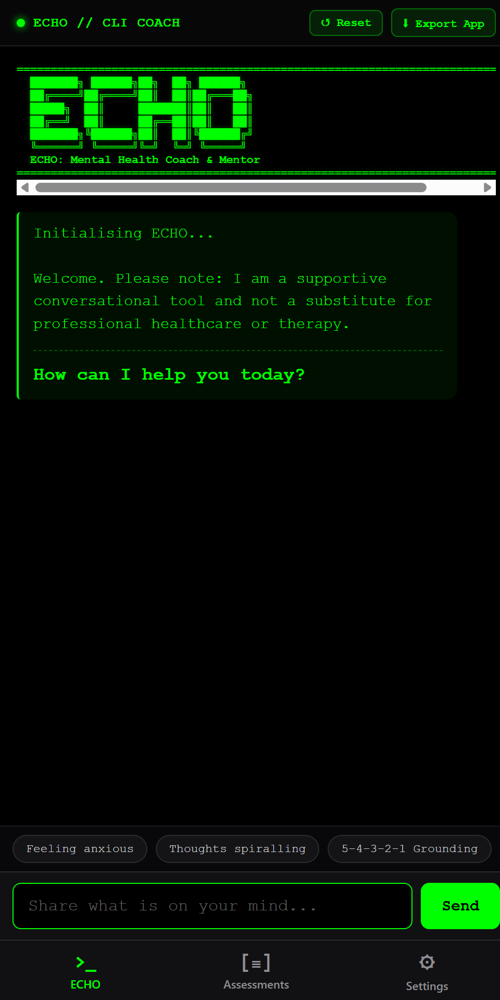

# ECHO: Mental Health Coach & Mentor (Standalone iPhone Application)

<p align="center">
  
</p>

## 1.0 Executive Operational Context

* **System Name:** ECHO // CLI Mental Health Coach & Mentor
* **Version:** 1.0.0 (Production Release)
* **Author:** Darren J. Ruddick (Lead Business Analyst & Healthcare Informatics Specialist)
* **Target Environment:** Apple iOS 16.4+ / iOS 17 / iOS 18 (iPhone & iPad)
* **Operating Modality:** 100% Client-Side Local Storage; Offline Caching via Service Worker; Zero Cloud Dependencies.

---

## 2.0 Problem-Impact-Mitigation (PIM) Framework

* **2.1 Empirical Baseline Exposure:** 
  The original source asset was exported directly from a cloud development canvas. Consequently, it contained 605 lines of Google Gemini iframe bridge wrappers, token refresh hooks, and websocket interceptors. These external hooks caused dependency timeouts and broken runtime behaviours when loaded outside a parent browser canvas. Furthermore, native iOS Safari requires strict Web App Manifest specifications, touch icon declarations, and safe-area padding to function without browser navigation chrome.

* **2.2 Systemic & Regulatory Impact:**
  Healthcare professionals and emergency staff requiring immediate grounding tools during shift work cannot tolerate network latency, login screens, or cloud tracking of sensitive psychological data. An unoptimised web file fails to persist clinical assessments (PHQ-9, GAD-7, GHQ-12) locally and risks data loss if the device enters low-connectivity clinical wards.

* **2.3 Technical Mitigation Delivered:**
  1. Complete removal of all external canvas interceptors, creating a clean single-page architecture (`index.html`).
  2. Implementation of an offline-first CacheStorage Service Worker (`sw.js`).
  3. Authoring of a compliant W3C Web App Manifest (`manifest.webmanifest`) enforcing `display: standalone` and portrait orientation.
  4. Generation of high-contrast Apple touch icons (180x180 PNG, 192x192 PNG, 512x512 PNG, SVG vector).
  5. Scaffolding of Capacitor (`@capacitor/core`, `@capacitor/ios`) for native Xcode compilation.
  6. Configuration of GitHub Actions CI/CD (`.github/workflows/build-ios.yml`) to build unsigned `.ipa` packages on cloud macOS runners.

* **2.4 Out of Scope:**
  * Provision of emergency medical diagnosis or formal psychiatric triage (governed strictly by clinical disclaimer).
  * Transmission of patient or user data to third-party cloud servers.
  * Integration with external electronic patient records (EPR) or commercial cloud databases.

---

## 3.0 Installation & Deployment Procedures

### Method A: Instant iPhone Home Screen Installation (Recommended - Zero Mac/Xcode Required)

* **Step 1A:** Ensure your iPhone and workstation are connected to the same local Wi-Fi network.
* **Step 2A:** Open a terminal window in the project root and start the internal delivery server:
  ```powershell
  npm run serve
  ```
* **Step 3A:** Observe the output IP address displayed in your terminal (e.g., `http://10.182.47.237:8080`).
* **Step 4A:** Open **Safari** on your iPhone and enter the IP address into the address bar.
* **Step 5A:** Tap the **Share** button located on the bottom toolbar (rectangle with upward arrow).
* **Step 6A:** Scroll down and select **Add to Home Screen**.
* **Step 7A:** Tap **Add** in the top right corner.
* **Step 8A:** Return to your iPhone Home Screen and tap the **ECHO** icon. The application launches full-screen with no URL bar, running independently offline.

---

### Method B: Automated GitHub Pages Cloud Deployment

* **Step 1B:** Push the project directory to your GitHub repository.
* **Step 2B:** Navigate to your repository **Settings** on GitHub.com.
* **Step 3B:** Select **Pages** from the left navigation pane.
* **Step 4B:** Set **Source** to **GitHub Actions** (the included `.github/workflows/build-ios.yml` handles deployment automatically).
* **Step 5B:** Navigate to your live GitHub Pages URL on your iPhone in Safari (e.g., `https://<username>.github.io/ECHO/`).
* **Step 6B:** Tap **Share** -> **Add to Home Screen**. The app is now permanently accessible and updates automatically upon subsequent git pushes.

---

### Method C: Native iOS App Compilation via Capacitor & GitHub Actions

* **Step 1C:** Push the codebase to GitHub.
* **Step 2C:** Navigate to the **Actions** tab on your GitHub repository.
* **Step 3C:** Select the **Build iOS Standalone App** workflow.
* **Step 4C:** Download the compiled artifact (`ECHO-iOS-Standalone.zip`) containing `ECHO-iOS.ipa`.
* **Step 5C:** Sideload the IPA onto your iPhone using AltStore, Sideloadly, or distribute internally via Apple TestFlight.

---

## 4.0 Verification & Test Directives

* **Test 1.0 (Standalone Chrome Removal):**
  Launch ECHO from the iOS Home Screen. Verify that Safari navigation bars, URL inputs, and bottom button bars do not render.

* **Test 2.0 (Keyboard Viewport Management):**
  Select the text input field in the Chat tab. Confirm that the virtual iOS keyboard slides up without obscuring the input bar or disrupting top status headers.

* **Test 3.0 (Offline Resilience):**
  Place the iPhone into Airplane Mode (Wi-Fi and Mobile Data disabled). Kill the ECHO app in the iOS App Switcher and relaunch it. Confirm complete operational availability across Chat, Assessments, and Settings tabs.

* **Test 4.0 (Clinical Assessment Persistence):**
  Navigate to the **Assessments** tab. Complete a PHQ-9 questionnaire. Verify that the score calculates correctly and appears immediately in the Saved Assessment History log upon return to the tool list.
